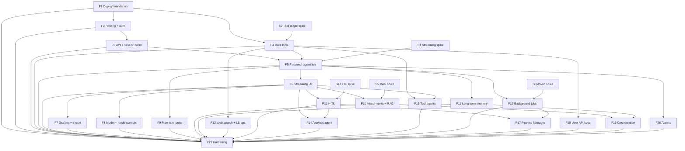

# Roadmap

Status: ACTIVE (F1 and F2 done; wave 2 — F3 and S2 — in progress). Source of truth for every decision referenced below is `.agents/decision-log.md`. This file gives the map; each phase's detail lives in `.agents/phases/<ID>-*.md`.

This file is owned by the documentation agent. The phase files S1–S10 (spikes) and F01–F10 are also owned by the documentation agent. Phase files F11–F21 are written in parallel by another agent using the same template; they are listed here for completeness but this file does not certify their content.

## 1. Phase table

| ID | Title | Goal (1 line) | Depends on | Specs touched | Status |
|---|---|---|---|---|---|
| S1 | Streaming spike | Prove REST API response streaming + Cognito authorizer + CloudFront works end to end before building the real Session Runner. | — | `architecture.md`, `streaming-protocol.md`, `api.md`, `auth-and-tool-scope.md` §9 | not started |
| S2 | Tool scope spike | Prove Cedar Policy + Cognito M2M scoped tokens can gate Gateway tool access per source, including `tools/list` filtering. | — | `auth-and-tool-scope.md`, `tools.md`, `security.md` (T3) | not started |
| S3 | Async spike | Prove an AgentCore Runtime async session can run over 1 hour, report `HealthyBusy`, be cancelled, and resume from `AgentCoreMemorySaver` after a kill. | — | `data-model.md` (Job ID Store), `agents.md` (async pattern), `architecture.md` §2.2 | not started |
| S4 | HITL spike | Prove a LangGraph `interrupt` can checkpoint, end a stream, and resume in a new run from a typed action. | — | `agents.md` (HITL), `api.md` (`/ui-actions`), `streaming-protocol.md` (`hitl_request`), `data-model.md` (AgentCore Memory) | not started |
| S5 | RAG spike | Prove Bedrock Knowledge Base with S3 Vectors ingests PNG/JPG/CSV via the FM parser and every retrieval honors a metadata filter. | — | `data-model.md` §7/§9, `tools.md` §7, `architecture.md` | not started |
| F1 | Deploy foundation | Stand up `deploy.sh`, CodeBuild, and the CDK skeleton so every later phase has somewhere to deploy to. | — | `architecture.md` (deploy foundation row), `security.md` (IaC hygiene) | done |
| F2 | Hosting + auth | Serve the `founder-ai-dashboard` SPA from S3/CloudFront/WAF with Cognito self sign-up and login. | F1 | `architecture.md` §1 (S3/CloudFront/WAF/Cognito rows), `auth-and-tool-scope.md` §1–2, `security.md` (network/edge) | done |
| F3 | API + session store | Stand up the one Regional REST API, the Cognito authorizer, throttling, and the Session Metadata + Chat History tables with list/history routes. | F2 | `api.md` (Sessions, Chat history), `data-model.md` §1–2, `auth-and-tool-scope.md` §9/§11 | not started |
| F4 | Data tools | Stand up the AgentCore Gateway, the 10 source Lambdas as targets, Cognito scopes, and Cedar Policy in `ENFORCE`. | F1, S2 | `tools.md` §1, `auth-and-tool-scope.md` (full) | not started |
| F5 | Research agent live | Deploy the Research runtime to AgentCore, wire the deterministic Session Router, and stream real answers over `/chat/stream`. | F3, F4, S1 | `agents.md` §1, `architecture.md` §2.1, `api.md` (`/chat/stream`), `streaming-protocol.md` (base) | not started |
| F6 | Streaming UI | Ship CEI UI 1.2 progressive SSE end to end: renderer, thinking block/trace, grounding pending state, trace storage. | F5 | `streaming-protocol.md` (full), `data-model.md` §2 (trace), `tools.md` §6 | not started |
| F7 | Drafting + export | Deploy the Drafting runtime and ship PDF/DOCX/MD/CSV/LaTeX/TXT export with the review-acknowledgment gate. | F6 | `agents.md` §2, `tools.md` §8, `api.md` (`/exports`), `data-model.md` §7 | not started |
| F8 | Model + mode controls | Ship the model picker with blocklist, per-chat science/business mode, Guardrails, and prompt caching. | F6 | `agents.md` §6, `api.md` (`/models`, `/settings`), `security.md` (model calls) | not started |
| F9 | Free-text router | Add the classifier-model path in the Session Router for free-text chat (task launcher routing is unchanged). | F5 | `agents.md` §5/§6, `api.md` | not started |
| F10 | Attachments + RAG | Ship attachment upload, SQS processing, KB ingestion, and per-chat retrieval filtering. | F6, S5 | `data-model.md` §5/§7, `tools.md` §7, `api.md` (Attachments) | not started |
| F11 | Long-term memory | AgentCore Memory long-term strategies (user preferences, semantic facts). | F5 | `data-model.md` §9, `agents.md` §6 | not started (owned by parallel agent) |
| F12 | Web search + LS ops | Web Search connector, Life Sciences Operations Lambda. | F4 | `tools.md` §3–4, `auth-and-tool-scope.md` §3 | not started (owned by parallel agent) |
| F13 | HITL | Real pause/resume in all agents, typed action endpoint in production. | F6, S4 | `agents.md` (HITL points), `api.md` (`/ui-actions`), `streaming-protocol.md` (`hitl_request`) | not started (owned by parallel agent) |
| F14 | Analysis agent | Full Analysis agent implementation. | F6, F13 | `agents.md` §3 | not started (owned by parallel agent) |
| F15 | Tool agents | 1 runtime + 11 YAML profiles, NCBI Gateway targets. | F4, F6 | `agents.md` §5, `tools.md` §2 | not started (owned by parallel agent) |
| F16 | Background jobs | Job ID Store, Polling Lambda, watchdog, cancel. | F5, S3 | `data-model.md` §3, `api.md` (Jobs) | not started (owned by parallel agent) |
| F17 | Pipeline Manager | Full Pipeline Manager implementation, plan approval, `/pipeline` job view. | F13, F16 | `agents.md` §4, `architecture.md` §2.4 | not started (owned by parallel agent) |
| F18 | User API keys | Settings page, Secrets Manager, key use in Gateway Lambdas. | F4 | `data-model.md` §8, `api.md` (`/settings/api-keys`) | not started (owned by parallel agent) |
| F19 | Data deletion | Delete chat, delete account cascades. | F10, F11 | `data-model.md` (Deletion cascade), `api.md` (Account) | not started (owned by parallel agent) |
| F20 | Alarms | CloudWatch alarms, SNS email, dashboards. | F5 | `security.md` (Observability), decision log B75 | not started (owned by parallel agent) |
| F21 | Hardening | Security review, load test, human docs complete. | all | `security.md` (full) | not started (owned by parallel agent) |
| Later | Deferred | PTC, slides export, paid sources, memory UI. | — | — | deferred, no phase file |

## 2. Dependency graph

Spikes S1–S5 have no dependencies on each other or on F1; they exist to answer open questions in the decision log (B2/B4 for S1, B30 for S2, B25 for S3, B56/B57 for S4, B33/B35/B38 for S5) before the feature phases that rely on their findings are built.

## 3. Suggested execution order

Work in waves. Inside a wave, every phase can run in parallel (different files, no shared edits); phases in different waves are ordered by the arrows above.

| Wave | Phases | Notes |
|---|---|---|
| 0 | S1, S2, S3, S4, S5, F1 | All independent. Deploy parallel subagents, one per phase, each reading only its own phase file plus the specs it names. Findings notes land in `.agents/phases/findings/<ID>.md`. |
| 1 | F2 | Needs F1's CDK skeleton and `deploy.sh`. |
| 2 | F3, F4 | F3 needs F2 (Cognito, CloudFront). F4 needs F1 (CDK skeleton) and S2's findings (Cedar/Cognito scope proof). Can run in parallel with each other. |
| 3 | F5 | Needs F3 (API + session store), F4 (Gateway + sources), and S1's findings (streaming proof). |
| 4 | F6, F9, F11, F12, F16, F18, F20 | All depend only on F5 or F4; run in parallel. F6 is the highest-priority of this wave since F7/F8/F10/F13/F15 (and, one wave later, F14) all wait on it. |
| 5 | F7, F8, F10, F13, F15 | All depend on F6 (plus S4 for F13, S5 for F10, F4 for F15). Run in parallel. F14 is deliberately not in this wave: the decision log lists F14's dependency as F6 **and** F13, so F14 must wait for wave 5's F13 to finish (B72's Analysis scope-confirmation HITL point needs F13's `interrupt` mechanism). |
| 6 | F14, F17 | F14 needs F13 (wave 5). F17 needs F13 and F16 (both wave 4/5). Run in parallel. |
| 7 | F19 | Needs F10 and F11. |
| 8 | F21 | Needs every other phase. Always last. |

Per `CLAUDE.md` (user global instructions): any implementation wave touching more than 3 files must be run with parallel subagents, monitored so each subagent stays inside its assigned phase's file list and does not edit sibling phase files or specs.

## 4. How to use these files (for coding agents)

1. Read `.agents/decision-log.md` fully first. It is the only source of truth for decisions; this roadmap and the phase files only restate it.
2. Read the specs your phase file names in its `Specs:` line, under `.agents/specs/`. Do not read specs your phase does not name unless you hit a cross-reference you need to resolve.
3. Read your one phase file under `.agents/phases/`. Do the tasks in order; each task is small enough to finish in about a day.
4. When you finish a task, check it off (`- [x]`) in the phase file. When every acceptance criterion is met and tests pass, change the phase file's `Status:` line to `done`. Use `in progress` while working and `blocked` if you cannot proceed (say why, and what decision or phase it is blocked on).
5. Only edit the one phase file you were assigned, plus the code paths it lists as deliverables. Do not edit other phase files, `roadmap.md`, or the specs.
6. If your work uncovers something that needs a new decision not already covered by a B-number (a real ambiguity, not something you can infer from the decision log), stop and ask the user. Do not invent a decision. Only record a new decision in `.agents/decision-log.md` after the user approves it — append a new `Bxx` row in the same table format, and update this roadmap's phase table row only if the decision changes that phase's dependencies or specs.
7. Spike phases (S1–S5) end with a findings note at `.agents/phases/findings/<ID>.md`, not a change to the decision log by itself — the findings note is evidence; a resulting decision still needs the step in point 6.
