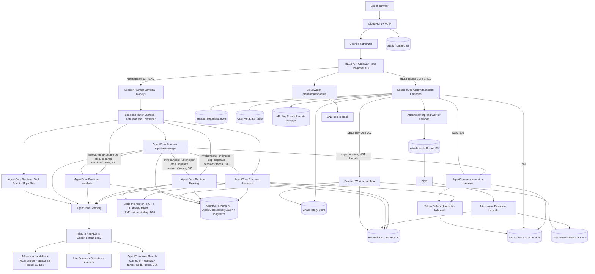

# Target Architecture

Status: planned. Source of truth: `.agents/decision-log.md` (decisions B1–B86). Where this file conflicts with `docs/media/architecture.png`, `docs/architectureDeepDive.md`, or `docs/agent-architecture-decisions.md` (D1–D17), this file and the decision log win.

Sibling specs (written in parallel, referenced here by name only): `data-model.md`, `api.md`, `streaming-protocol.md`, `security.md`.

Status legend: **planned** = not yet built. **exists (partial)** = some code exists locally but the AWS resource or production wiring is not built.

## 1. Component Table

| Component | Purpose | Phase | Status |
|---|---|---|---|
| S3 static bucket + CloudFront | Hosts the `founder-ai-dashboard` Vite SPA build (B1) | F2 | planned |
| CDN WAF | Protects CloudFront | F2 | planned |
| Cognito user pool + app clients | Self sign-up, email verify, SPA PKCE client, Router M2M client (B13/B14/B30) | F2 | planned |
| REST API Gateway (single, Regional, v1) | All routes; `/chat/stream` uses `responseTransferMode: STREAM`; one Cognito authorizer (B2) | F3 (base), S1 (streaming proof) | planned |
| Session Runner Lambda (Node.js) | Native response streaming; relays `InvokeAgentRuntime` chunks over SSE; writes each SSE event with a sequence number to the Chat History Store for reconnect replay (B3/B68) | S1 (spike), F5 (live) | planned |
| Session Router Lambda (Python) | Deterministic lookup for dashboard tasks (Goals 1–3) + classifier model call for free text (B15/B17); on low classifier confidence, returns a `ChoicePicker` of the 4 agents instead of guessing (B80); also routes `/tools/{source}/chat/stream` by reading `source` (B84) | F5 (deterministic), F9 (classifier) | planned |
| Token Refresh Lambda (Python, internal, IAM auth) | `POST /internal/token-refresh` — checks the Job ID Store (background jobs) or the Active-run counters record (real-time runs) for an active run, then mints a new scoped M2M token with the same scopes and user (B67). The calling agent never holds the M2M client secret. | F4 | planned |
| Deletion Worker Lambda | Account-delete only (B104; no chat delete). Runs on a schedule, 9 hours after the `202 Accepted` response, once the account "deleting" gate and the 8 h run maximum have ended any late write (B58, B73, B109) | F19 | planned |
| AgentCore Runtime — Research | Goal 1 specialist agent | F5 | exists (partial) — LangGraph graph runs locally (`backend/agents/research/`); no runtime deployment, no `AgentCoreMemorySaver` |
| AgentCore Runtime — Drafting | Goal 2 specialist agent | F7 | exists (partial) — graph and nodes implemented locally; same gaps as Research |
| AgentCore Runtime — Analysis | Goal 3 specialist agent | F14 | exists (partial) — graph wired, all nodes `raise NotImplementedError` |
| AgentCore Runtime — Pipeline Manager | Goal 4 orchestrator | F17 | exists (partial) — graph wired, all nodes `raise NotImplementedError` |
| AgentCore Runtime — Tool Agent (1 runtime, 11 YAML profiles) | Single-source natural-language chat (B21/B27/B29) | F15 | planned |
| AgentCore Gateway | MCP-based access to the 10+NCBI source Lambdas and Life Sciences Ops (B19/B26) | F4 | planned |
| Policy in AgentCore (Cedar) | Default-deny, per-source scope enforcement, `tools/list` filtering (B30) | S2 (spike), F4 (prod) | planned |
| 10 data source Lambdas | PubMed, ClinicalTrials.gov, bioRxiv, medRxiv, ChEMBL, Open Targets, CMS Coverage, ICD-10, NPI Registry, PubChem | F4 | exists (partial) — `_direct_invoke` HTTP calls implemented in `backend/agents/shared/tools/data_sources/`; no Lambda deployment, no Gateway target |
| NCBI Gateway targets (BLAST, taxonomy, sequence/efetch) | New targets for the NCBI tool agent (B27) | F15 | planned |
| Life Sciences Operations Lambda | Deterministic Biopython/RDKit helpers (B42) | F12 | planned |
| AgentCore Web Search connector | Built-in connector `web-search` v1.2.0 (B44) | F12 | planned |
| AgentCore Code Interpreter | Sandbox for charts, PDF/DOCX export | F1 (CDK) | exists (partial) — `CodeInterpreterCustom` defined in `backend/lib/backend-stack.ts`; not yet granted to any runtime |
| AgentCore Memory (short-term: `AgentCoreMemorySaver`) | Checkpointer for crash resume and HITL pause/resume (B28) | S3/S4 (spikes), F5+ (wired in) | exists (partial) — `shared/memory/agentcore.py` exists; agents still use `InMemorySaver` |
| AgentCore Memory (long-term strategies) | User preferences, semantic facts, corrections (B34/B37) | F11 | planned |
| Bedrock Knowledge Base + S3 Vectors | RAG over attachments, FM parser for PNG/JPG/CSV (B33/B35/B38) | S5 (spike), F10 (prod) | planned |
| Job ID Store (DynamoDB) + Polling Lambda + watchdog | Background job status; watchdog resumes stale jobs from checkpoint (B25) | F16 (spike: S3) | planned |
| Attachments Bucket (S3) + Attachment Upload Worker Lambda | Pre-signed POST, 55 MB max (B32) | F10 | planned |
| SQS attachment queue + Attachment Processor Lambda | Metadata extraction, permission check, KB ingestion trigger | F10 | planned |
| Attachment Metadata Store (DynamoDB) | Per-chat file metadata (B31) | F10 | planned |
| Session Metadata Store (DynamoDB) + Session Metadata Handler Lambda | Session list, titles, status | F3 | planned |
| Chat History Store (DynamoDB) | Indefinite retention; trace stored inline, gzip + chunked over 400 KB, sequence-numbered SSE events for reconnect replay (B8/B9/B68) | F3 | planned |
| Session History Handler Lambda | Cursor-paginated turn loading (B59) | F3 | planned |
| User Metadata Table (DynamoDB) + Fetch User Settings Lambda | Settings, configured sources, AI provider prefs. No per-user model restriction beyond the global blocklist (B76). | F18 (Proposal — not decided exactly when base read access lands; see TBD) | planned |
| API Key Store (Secrets Manager) | User-owned keys per user (B20) | F18 | planned |
| CloudWatch dashboards + alarms + SNS | AWS-console-only observability (B49/B50) | F20 | planned |
| Guardrails (Bedrock) | Input PII/PHI mask only (B51/B51a) | F8 | planned |
| Model picker + env-var blocklist | Per-chat model selection (B18/D3) | F8 | exists (partial) — `shared/config.py` has one fixed `default_model_id`; no picker, no blocklist enforcement |
| Prompt caching | Cache checkpoints on system prompt + tool defs (D16) | F8 | planned — `get_model()` in `shared/utils.py` sets no `cachePoint` |
| CEI UI 1.2 (progressive SSE patches) | `surface_begin`/`component_add`/`text_delta`/... events (B60) | F6 | planned — CEI UI 1.1 completed-JSON surfaces exist; SSE helper (`shared/transport/sse.py`) exists but no route uses it |
| Deploy foundation (`deploy.sh`, CodeBuild, CDK skeleton) | Guided single-environment deployment (B46/B47) | F1 | planned |

## 2. Request Flows

### 2.1 Real-time chat (streaming path, SSE)

```
Client → CloudFront → Cognito authorizer → REST API Gateway "/chat/stream" (STREAM)
  → Session Runner Lambda (Node.js, native streaming)
    → Session Router Lambda (deterministic lookup for a dashboard task, OR classifier model call for free text — B15/B17;
       on low classifier confidence, returns a ChoicePicker of the 4 agents instead of guessing — B80)
      → AgentCore Runtime (Research | Drafting | Analysis | Pipeline Manager)
        → AgentCore Gateway (Cedar Policy check) → data source Lambda(s) incl. NCBI (B85) / LS Ops / KB retrieval / Web Search connector (B86 — a Gateway target, Cedar-gated)
        → Code Interpreter (direct runtime binding via bedrock-agentcore, NOT a Gateway target — B86)
        → AgentCoreMemorySaver checkpoint per turn
        → long-running turn calls the Token Refresh Lambda (IAM auth) before its tool token expires (1 h TTL, B67)
  ← Session Runner relays chunks as SSE (heartbeat every 15–20s, CachingDisabled, no compression on /chat/*)
    and writes each event with a sequence number to the Chat History Store (B68)
Client renders progressive CEI UI 1.2 patches, ends with the completed surface.
On disconnect, the client reconnects with its last sequence number; the server replays the missing
events from the Chat History Store, then continues live (B68 — see `streaming-protocol.md`).
If the plan/triage step's own estimate exceeds 10 minutes, this decision is made up front (before any
component streams) and the run hands off to a background job instead — no mid-run handoff (B79).
```
Limits: 15-minute API Gateway streaming cap, 5-minute idle (Regional), 2 MB/s after the first 10 MB (see research facts; detailed in `streaming-protocol.md`).

### 2.2 Background jobs (async path)

```
Client → REST API Gateway (BUFFERED route, e.g. POST /pipelines or a plan-based async decision — B23/B79,
         threshold 10 minutes, decided once before streaming starts, no mid-run handoff)
  → Lambda starts an AgentCore Runtime ASYNC session (NOT Fargate — B25, Fargate is removed)
    → entrypoint returns at once; work runs via add_async_task/complete_async_task; runtime pings HealthyBusy
    → AgentCoreMemorySaver checkpoints for crash resume
    → calls the Token Refresh Lambda (IAM auth) to renew its tool token every &lt;1 h while the Job ID Store shows the job active (B67)
  → Job ID Store (DynamoDB) tracks status
Client polls GET /jobs/:id (Polling Lambda) or opens /pipeline for live step status (B54).
Watchdog (scheduled) marks stale jobs failed and can resume from the last checkpoint.
Cancel: cooperative in-graph flag + StopRuntimeSession.

Pipeline Manager only (B83): each plan step calls the target specialist agent runtime with
InvokeAgentRuntime (not an in-process call). Concurrent steps run in separate AgentCore Runtime
sessions (each its own 2 vCPU / 8 GB) with separate traces per step.
```

### 2.6 Delete path (account only, B104)

There is no chat delete. `DELETE /sessions/{id}` is removed (B104).

```
Client → REST API Gateway → POST /account/delete (behind a flag, off by default)
  → Cognito AdminDisableUser + AdminUserGlobalSignOut; account "deleting" gate written
  → every run-starting route checks the gate first; no new run can start
  → response 202 Accepted at once (B73); running AgentCore sessions end on their own (8 h max)
  → 9 hours later, a scheduled Deletion Worker Lambda removes DynamoDB items, S3 files,
    KB chunks, memories and checkpoints (B109 — the delay covers the 8 h run max plus the
    1 h access-token life, so a late write has already finished; no epoch-conditional write needed)
Client hides the account's data at once on the 202 response (B73).
```

### 2.3 Attachment path

```
Client → REST API Gateway → Attachment Upload Worker Lambda → pre-signed S3 POST (max 55 MB, content-length-range — B32)
Client → PUTs file to Attachments Bucket
S3 event → SQS → Attachment Processor Lambda
  → extract metadata, permission check (per-chat scope — B31)
  → write Attachment Metadata Store (DynamoDB)
  → trigger Bedrock KB ingestion (S3 Vectors, chunk metadata: user_id, session_id, file_id — B33)
CSV also goes to the Code Interpreter as a file; PNG/JPG also go directly to vision-capable models (B38).
```

### 2.4 HITL pause/resume path

```
Agent node calls an inline HITL tool (ask_user_question | present_alternatives | request_plan_approval | get_user_input)
  → LangGraph `interrupt` (B56) → AgentCoreMemorySaver checkpoint saved
  → stream ends with the question surface (CEI UI ReviewGate/ChoicePicker/TextField)
  → chat shows "waiting for you", no fixed time limit (B57), up to the AgentCore Memory short-term
    event's maximum expiry (expected ~365 days, value to verify); past that, the surface shows
    "expired, start again" instead of resuming (B82)
Client sends the answer as a typed POST action (session, surface, revision, component, interaction IDs)
  → action endpoint validates → resumes the saved graph in a new run from the checkpoint
For long waits during an async job: checkpoint, stop the AgentCore session, resume in a new session after approval (B25).
```

### 2.5 Tool-agent path (single data source, natural-language)

```
Client (Tools page, e.g. "Ask PubMed") → POST /tools/{source}/chat/stream (STREAM, same Session
  Runner, B84) → Session Router reads {source} from the path
  → AgentCore Runtime — Tool Agent (1 runtime, 1 generic graph, loads the YAML profile for the requested source — B29)
    → AgentCore Gateway, Cognito token scoped to ONLY that source's scope (B30)
    → Code Interpreter and other standard tools remain available; no other external data source
```
Specialist agents (2.1) never call tool agents; both paths share the same Gateway Lambdas (B26). NCBI is available on both paths (B85): as one of the specialist agents' 11 source scopes, and as one of the 11 tool-agent profiles.

## 3. Diagram



## 4. Differences from `docs/media/architecture.png`

| Original diagram | Target (this spec) | Why |
|---|---|---|
| Fargate Agent Runner Cluster for background jobs | AgentCore Runtime **async sessions** (max 8 h, 2 vCPU/8 GB) | B25: Fargate is removed. Job ID Store and Polling Lambda stay; a watchdog is added for stale-job recovery. |
| Separate "Streaming API Gateway" and "REST API Gateway" boxes | **One** Regional REST API (v1) for all routes | B2: HTTP API (v2) cannot stream; one API with per-route `responseTransferMode`. |
| Session Router shown as a simple no-model dispatcher | Session Router Lambda does deterministic lookup **and** a small fixed-model classifier call for free text | B15/B17: routing is unchanged for dashboard tasks; free-text chat is new. |
| No tool-agent runtime | New AgentCore Runtime: 1 generic graph, 11 YAML profiles (10 sources + NCBI) | B21/B27/B29: single-source natural-language chat, separate from the specialist agents. |
| Generic "Web search" box under Agent Core Tools | The specific AgentCore built-in connector `web-search` v1.2.0, region-gated (us-east-1, eu-west-1, ap-northeast-1), registered as a Gateway target and Cedar-gated under `cei-tools/common` (not a bypass of the Gateway) | B44: terms forbid bulk storage; only cited snippets are kept. B86: it is a Gateway target, unlike Code Interpreter. |
| No policy/authorization layer drawn in front of the Gateway | Policy in AgentCore (Cedar), default-deny, `tools/list` filtering, `LOG_ONLY` → `ENFORCE` | B30: new in 2026; needed for per-user, per-source tool scoping. |
| "AgentCore Managed RAG" (unspecified) | Bedrock Knowledge Base backed by **S3 Vectors**, per-chunk `user_id`/`session_id`/`file_id` metadata filter | B33/B35. |
| No Life Sciences Operations Lambda | New deterministic Biopython/RDKit Lambda (likely container image) | B42. |
| Static dashboard report pages (Target Assessment, Variant Report, Regulatory Brief) shown as future outputs | Removed; the founder-ai-dashboard mock pages for these are demo-only | B53. |

## 5. TBD

- Trace chunk DynamoDB key schema for entries over 400 KB (B9) — chunk size is decided (350 KB, B78); the key schema is deferred to `data-model.md`.
- AgentCore Memory short-term event expiry: exact maximum number needs verification against AWS docs (expected ~365 days); the HITL behavior on expiry ("expired, start again") is decided (B82).
- Exact phase for base User Metadata Table read access vs. the F18 (user API keys) bundling — labeled **Proposal (not decided)** above.
- Design of user-configured paid sources (deferred by the product owner).
- Product name and branding (affects no architecture decision, noted for completeness).
- Router low-confidence threshold value — implementation default, tuned in F9 (B80).
- Exact Cedar action-name string for the Web Search connector's Gateway target — illustrative pending S2 (B86).

Resolved by B67–B86 (see decision log): token refresh endpoint (B67), stream reconnect via Chat History Store sequence numbers (B68), Cedar per-target permits (B69), shared `cei-tools/common` scope (B70), Drafting's in-process research subgraph stays (B71), HITL points (B72), delete API 202 + Deletion Worker (B73), agent- and user-triggered export (B74), alarm list with no agent-health alarms (B75), no per-user model restriction (B76), KB retrieval as a Gateway Lambda target (B77), the defaults in B78, async threshold 10 minutes with no mid-run handoff (B79), Router low-confidence `ChoicePicker` fallback (B80), the export review checkbox UI (B81), HITL expiry behavior (B82), Pipeline Manager's `InvokeAgentRuntime` dispatch (B83), the tool-agent stream route (B84), specialist agents also get the NCBI scope (B85), and the Web Search/Code Interpreter Gateway-target distinction (B86).
