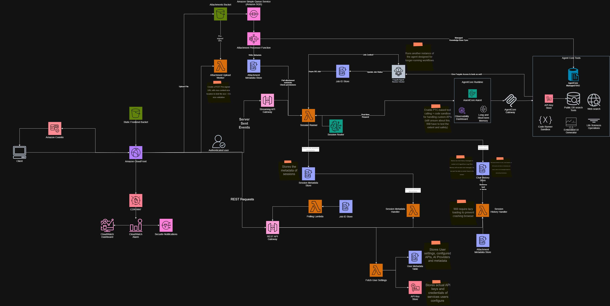

# [INSERT_PROJECT_NAME]

[INSERT_PROJECT_DESCRIPTION - 2-3 sentences describing what the project does, who it's for, and the key problem it solves]

---

> **🚀 New to this template?** Start with the [GETTING_STARTED.md](./GETTING_STARTED.md) guide for setup instructions and best practices.

---

## Disclaimers

Customers are responsible for making their own independent assessment of the information in this document. This document:

(a) is for informational purposes only,

(b) references AWS product offerings and practices, which are subject to change without notice,

(c) does not create any commitments or assurances from AWS and its affiliates, suppliers or licensors. AWS products or services are provided "as is" without warranties, representations, or conditions of any kind, whether express or implied. The responsibilities and liabilities of AWS to its customers are controlled by AWS agreements, and this document is not part of, nor does it modify, any agreement between AWS and its customers, and

(d) is not to be considered a recommendation or viewpoint of AWS.

Additionally, you are solely responsible for testing, security and optimizing all code and assets on GitHub repo, and all such code and assets should be considered:

(a) as-is and without warranties or representations of any kind,

(b) not suitable for production environments, or on production or other critical data, and

(c) to include shortcuts in order to support rapid prototyping such as, but not limited to, relaxed authentication and authorization and a lack of strict adherence to security best practices.

All work produced is open source. More information can be found in the GitHub repo.

---

## Visual Demo


> **[PLACEHOLDER]** Please provide a GIF or screenshot of the application interface and save it as `docs/media/user-interface.gif`

---

## Table of Contents

| Index                                               | Description                                              |
| :-------------------------------------------------- | :------------------------------------------------------- |
| [**Getting Started Guide**](./GETTING_STARTED.md)  | **Setup instructions and best practices for this template** |
| [High Level Architecture](#high-level-architecture) | High level overview illustrating component interactions  |
| [Deployment Guide](#deployment-guide)               | How to deploy the project                                |
| [User Guide](#user-guide)                           | End-user instructions and walkthrough                    |
| [API Documentation](#api-documentation)             | Documentation on the APIs the project uses               |
| [Directories](#directories)                         | General project directory structure                      |
| [Modification Guide](#modification-guide)           | Guide for developers extending the project               |
| [Troubleshooting](#troubleshooting)                 | Common issues and solutions                              |
| [Removing Commit History](#removing-commit-history) | Steps to clean commit history when using as a template   |
| [Credits](#credits)                                 | Contributors and acknowledgments                         |
| [License](#license)                                 | License information                                      |

---

## High Level Architecture

[INSERT_ARCHITECTURE_OVERVIEW - Brief paragraph explaining the architecture, how components interact, and the overall system design]



> **[PLACEHOLDER]** Please create and provide an architecture diagram showing:
> - All major components/services
> - Data flow between components
> - User interaction points
> - External services/APIs
> 
> Save the diagram as `docs/media/architecture.png` (or .jpeg/.jpg)

For a detailed explanation of the architecture and architectural decisions, see the [Architecture Deep Dive](./docs/architectureDeepDive.md).

---

## AI-DLC Development Workflow

This project was built using **AI-DLC (AI Development Lifecycle)**, a structured workflow that guides AI through requirements → design → implementation → testing.

**For developers working on this project:**
- See [AI-DLC Documentation](./ai_dlc_files.md) for complete details on:
  - How to use AI-DLC for new features
  - Writing effective prompts
  - Understanding generated documentation in `aidlc-docs/`
  - Adding custom development rules

**Quick Start:**
```
using AI-DLC: [describe your feature or change]
```

> **Note**: Remove this section before production deployment.

---

## Deployment Guide

For complete deployment instructions, see the [Deployment Guide](./docs/deploymentGuide.md).

**Quick Start:**
1. [INSERT_QUICK_START_STEP_1]
2. [INSERT_QUICK_START_STEP_2]
3. [INSERT_QUICK_START_STEP_3]

---

## User Guide

For detailed usage instructions with screenshots, see the [User Guide](./docs/userGuide.md).

---

## API Documentation

For complete API reference, see the [API Documentation](./docs/APIDoc.md).

---

## Modification Guide

For developers looking to extend or modify this project, see the [Modification Guide](./docs/modificationGuide.md).

---

## Directories

```
├── backend/
│   ├── bin/
│   │   └── backend.ts
│   ├── lambda/
│   │   └── [INSERT_LAMBDA_FUNCTIONS]
│   ├── lib/
│   │   └── backend-stack.ts
│   ├── agent/
│   │   └── [INSERT_AGENT_FILES]
│   ├── cdk.json
│   ├── package.json
│   └── tsconfig.json
├── frontend/
│   ├── app/
│   │   ├── layout.tsx
│   │   ├── page.tsx
│   │   └── globals.css
│   ├── public/
│   └── package.json
├── docs/
│   ├── architectureDeepDive.md
│   ├── deploymentGuide.md
│   ├── userGuide.md
│   ├── APIDoc.md
│   ├── modificationGuide.md
│   └── media/
│       ├── architecture.png
│       └── user-interface.gif
├── LICENSE
└── README.md
```

### Directory Explanations:

1. **backend/** - Contains all backend infrastructure and serverless functions
   - `bin/` - CDK app entry point
   - `lambda/` - AWS Lambda function handlers
   - `lib/` - CDK stack definitions
   - `agent/` - [INSERT_AGENT_DESCRIPTION]

2. **frontend/** - Next.js frontend application
   - `app/` - Next.js App Router pages and layouts
   - `public/` - Static assets

3. **docs/** - Project documentation
   - `media/` - Images, diagrams, and GIFs for documentation

---

## Troubleshooting

### MCP Servers Not Connecting

**Issue**: MCP servers show "Disconnected" status in Kiro

**Solutions**:
1. Verify `uv` and `uvx` are installed: `uvx --version`
2. Check AWS credentials: `aws sts get-caller-identity`
3. Update AWS profile in `.kiro/settings/mcp.json`
4. Restart Kiro or reconnect servers from MCP Server view

### Spec Generation Fails

**Issue**: Kiro fails to create specification documents

**Solutions**:
1. Ensure you're in **Autopilot mode** (required for subagent delegation)
2. Verify scope documents are readable and well-formatted
3. Check that `.kiro/agents/cic-project-specs.md` exists
4. Try with a simpler project description first

### Subagent Not Delegating

**Issue**: Kiro implements code directly instead of delegating to subagents

**Solutions**:
1. Confirm you're in **Autopilot mode**
2. Use clear domain keywords (backend, frontend, deploy, security)
3. Explicitly request: "Use cic-backend agent to implement this"
4. Check `.kiro/steering/main-agent-orchestration.md` is present

### CDK Deployment Fails

**Issue**: `cdk deploy` fails with errors

**Solutions**:
1. Run `cdk synth` first to check for issues
2. Verify AWS credentials: `aws sts get-caller-identity`
3. Check cdk-nag findings and address or suppress them
4. Ensure CDK is bootstrapped: `cdk bootstrap`
5. Review CloudFormation events in AWS Console

### Amplify Build Fails

**Issue**: Amplify build fails after deployment

**Solutions**:
1. Check `AMPLIFY_MONOREPO_APP_ROOT` is set to `frontend`
2. Verify `buildSpec` in CDK matches your project structure
3. Check Amplify build logs in AWS Console
4. Ensure Next.js version is 12-15 (not 16+)
5. Verify environment variables are set on the branch

### Frontend Can't Connect to Backend

**Issue**: Frontend shows CORS errors or can't reach the sessions API or the agents

**How CORS is wired (deploy time)**: every layer uses one origin list built in `backend/lib/backend-stack.ts`: the `SiteUrl` output, plus `http://localhost:5173` only when `allowLocalhostCallback` is set.
- **Sessions API** (`/sessions`, `/sessions/{id}`, `/sessions/{id}/history`): API Gateway answers the `OPTIONS` preflight (Authorization, Content-Type, Accept). The Lambdas echo the request origin from `ALLOWED_ORIGINS` on every response. Gateway errors (401/403/429/4xx/5xx) carry `Access-Control-Allow-Origin: <SiteUrl>`, so a localhost origin sees those specific errors as CORS failures.
- **Agents** (browser → `AgentProxy` Lambda function URL → AgentCore runtime): the browser never calls `bedrock-agentcore.*` directly, because AgentCore documents no CORS support and its JWT authorizer would reject a preflight (preflights never carry `Authorization`). The SPA POSTs to `<AgentProxyUrl><agent>` (`research`, `drafting`, `analysis`, `pipeline`). The function URL's CORS (POST; authorization, content-type, accept, session-id header; no credentials; max-age 3600) is answered by the Lambda service itself. `backend/lambdas/agent-proxy/handler.py` checks for a bearer token and a valid session id, then forwards the caller's own token to the runtime, where AgentCore's Cognito authorizer and `identity.py` verify it. The proxy URLs reach the SPA through `/config.json` `agentUrls`, and the site CSP `connect-src` allows `https://*.lambda-url.<region>.on.aws`. The runtimes still get `CEI_ALLOWED_ORIGINS` (`app_factory.py`), which only matters if a browser ever calls them directly.

**Solutions**:
1. Check `/config.json` on the deployed site: it must contain `apiBaseUrl` and four `agentUrls` that start with the `AgentProxyUrl` stack output.
2. In DevTools, check the `OPTIONS` request. It must return 200 with `Access-Control-Allow-Origin` equal to the site origin.
3. If an agent call fails, check the `AgentProxyLogs` log group: each request logs the agent, status and duration (never the token, session id or body). A 401 there means AgentCore rejected the token; sign in again.
4. Confirm the site origin matches `SiteUrl` exactly (scheme and host, no trailing slash).

### Local development

1. Copy `frontend/public/config.example.json` to `frontend/public/config.json` and fill in the Cognito values from the stack outputs. Keep `"apiBaseUrl": "/api"` and leave `agentUrls` out, so agent calls use the `/api/agents/*` dev proxy.
2. Create `frontend/.env.local` with `CEI_API_BASE_URL=<ApiBaseUrl stack output>` (e.g. `https://<id>.execute-api.<region>.amazonaws.com/<stage>`). The dev server then proxies `/api/sessions/*` to the deployed API, so no CORS applies. Without it, `npm run dev` prints a warning, and chat history and resume will not work.
3. Start the agents locally on ports 8080 (research), 8081 (drafting), 8083 (analysis) and 8084 (pipeline) via `CEI_RUNTIME_PORT`. Leave `CEI_ALLOWED_ORIGINS` unset; the requests are same-origin through the proxy.

### Security Scan Failures

**Issue**: cdk-nag or security scans report violations

**Solutions**:
1. Review findings and fix resource configurations
2. Add suppressions with ADR-format reasons if intentional
3. Consult `.kiro/steering/security/` files for guidance
4. Use `cic-security` agent to review and fix issues

### Need More Help?

- **Kiro Documentation**: Check `.kiro/README.md` for MCP and Power setup
- **Steering Files**: Review `.kiro/steering/` for domain-specific guidance
- **AWS Documentation**: Use AWS documentation MCP server for latest info
- **GitHub Issues**: File issues in this repository for template problems

---

## Removing Commit History

When using this as a template for a new repo, you can strip the entire commit history to start fresh with a single initial commit:

```bash
git checkout --orphan fresh-start
git add -A
git commit -m "Initial commit"
git remote add new-origin https://github.com/REPO_OWNER/REPO_NAME.git
git branch -D main
git branch -m main
git push origin main --force
```

> **Warning:** `--force` rewrites the remote branch history. Only do this on a repo you own and before collaborators have cloned it.

---

## Credits

This application was developed by:

- <a href="[INSERT_LINKEDIN_URL]" target="_blank">[INSERT_CONTRIBUTOR_NAME_1]</a>
- <a href="[INSERT_LINKEDIN_URL]" target="_blank">[INSERT_CONTRIBUTOR_NAME_2]</a>
- <a href="[INSERT_LINKEDIN_URL]" target="_blank">[INSERT_CONTRIBUTOR_NAME_3]</a>

[INSERT_ADDITIONAL_ACKNOWLEDGMENTS - Teams, supporters, or organizations to acknowledge]

---

## License

This project is licensed under the MIT License - see the [LICENSE](./LICENSE) file for details.
