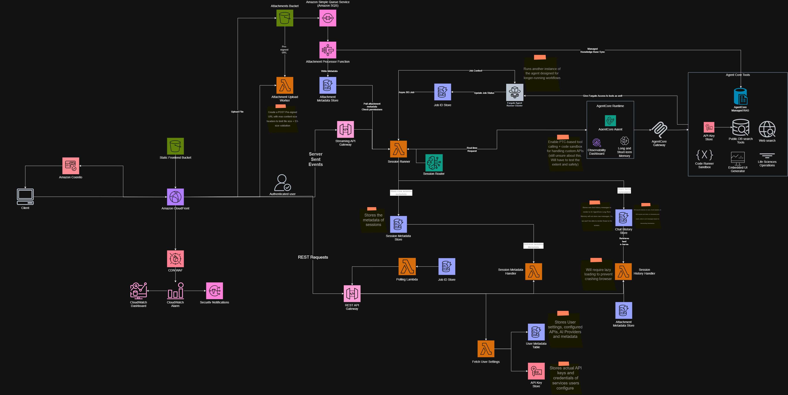

# Architecture Deep Dive

CEI Life Sciences Bot — an AI-powered life sciences assistant for many isolated users.

Status: this document describes the **target** architecture. Every component below is marked **Exists**, **Exists (partial)**, or **Planned — not built**. "Exists" means the code and the CDK definition exist at this commit. It does not mean that a live deployed check passed; see the phase files in `.agents/phases/` for verification status. Full detail and rationale live in `.agents/specs/architecture.md` (agent-facing spec); this page links to it instead of repeating it. Source of truth for all decisions: `.agents/decision-log.md` (decisions B1–B90).

---

## Architecture Diagram



**This diagram is not updated.** It shows an earlier design (for example, a Fargate cluster for background jobs and separate streaming/REST API Gateway boxes). See "Differences from the diagram" below for what changed. The `.agents/specs/architecture.md` mermaid diagram reflects the current target; this PNG does not.

---

## Status Legend

- **Exists** — deployed, or real code that runs today (locally or via CDK).
- **Exists (partial)** — some code exists, but the AWS resource or production wiring is missing.
- **Planned — not built** — no code or AWS resource exists yet.

---

## 1. Client Access

**Exists (F2, B88–B90).** CloudFront + WAF front a static SPA build on S3. Amazon Cognito (self sign-up, email verification, no MFA per B14) authenticates users through Cognito managed login (Authorization Code + PKCE, `oidc-client-ts`). The `CLOUDFRONT`-scope WAF web ACL lives in its own stack, `EdgeWafStack`, which always deploys to `us-east-1` (AWS only accepts that scope there) and is consumed by `BackendStack` through `crossRegionReferences: true`, regardless of which Region the rest of the stack deploys to. Every user's data (chats, keys, attachments, settings) will be fully isolated by Cognito `sub` — no sharing, no teams (isolation itself lands with the data stores in later phases).

The production frontend is the `founder-ai-dashboard` Vite SPA (React 19, Tailwind 4, react-router) in `frontend/` (B1/B66). Its CEI UI renderer is in `frontend/src/components/cei-ui/`, and its stream reducer is in `frontend/src/lib/stream/`. The archived Next.js app lives in `archive/frontend-next/` for reference only. It is not deployed.

**Exists:** the Cognito resource server and Router M2M client (`backend/lib/constructs/tool-gateway.ts`), and the REST API Cognito authorizer (`backend/lib/backend-stack.ts`).

**Exists (partial) (B112) — built in code, not yet deployed.** A one-time founder onboarding page (First name, Last name, Date of birth) after first sign-in, with an 18+ age gate. The three fields are standard Cognito user attributes (`given_name`, `family_name`, `birthdate`) on the existing user pool — no new table. `backend/lambdas/profile-handler/` (`POST /profile`, CDK construct `backend/lib/constructs/profile.ts`) writes them once (`AdminUpdateUserAttributes`) and disables an under-18 user (`AdminDisableUser` + `AdminUserGlobalSignOut`). The pre-token-generation trigger's new user-token branch adds a `cei_age_verified` claim; the Session Runner, UI actions, Session Metadata Handler, Models/Settings Handler, Jobs Handler, attachment presign, and the agent runtimes all require it (`403 onboarding_required` if missing). The SPA has a matching `/onboarding` page and `RequireOnboarding` gate. Needs live AWS verification — no deploy has run yet. See `.agents/decision-log.md` B112 and `.agents/specs/auth-and-tool-scope.md` §14.

---

## 2. Real-Time Chat (Streaming Path — SSE)

**Exists (partial).** The flow below is the target. The status notes after the diagram show what exists.

```
Client → CloudFront + WAF → Cognito authorizer → REST API Gateway "/chat/stream" (STREAM)
  → Session Runner Lambda (Node.js, native streaming)
    → Session Router Lambda (deterministic lookup for a dashboard task, OR a small fixed-model
       classifier call for free text; on low classifier confidence, the Router asks the user
       to pick one of the 4 agents with a ChoicePicker instead of guessing)
      → AgentCore Runtime (Research | Drafting | Analysis | Pipeline Manager)
        → AgentCore Gateway (Cedar Policy check) → data source Lambda(s) (including NCBI — specialists
           get every source scope) / Life Sciences Ops / Knowledge Base retrieval / Web Search connector
           (a Gateway target, Cedar-gated)
        → Code Interpreter (not a Gateway target — reached directly, gated by IAM/runtime binding)
        → AgentCoreMemorySaver checkpoint per turn
  ← Session Runner relays chunks as SSE (SSE comment ": heartbeat" every 17 s)
Client renders progressive CEI UI 1.2 patches, ending with the completed surface.
If the plan step's own estimate exceeds 10 minutes, that decision is made once, before any part
of the answer streams, and the run hands off to a background job instead — there is no mid-run
handoff from a streaming run to an async job.
```

**Planned — not built.** A single-source "tool agent" chat (for example, "Ask PubMed") uses its own streaming route, `POST /tools/{source}/chat/stream`, handled by the same Session Runner and the same event catalog; the Router reads `{source}` from the path to pick the profile and the single-source token.

There is **one Regional REST API Gateway (v1)** for every route, not an HTTP API (v2), because v2 cannot stream. `/chat/stream` uses `responseTransferMode: STREAM`; every other route is `BUFFERED`. One Cognito authorizer covers both modes. Limits: 15-minute streaming cap, 5-minute idle, 2 MB/s after the first 10 MB.

**Exists:** the REST API (stage `v1`) with its Cognito authorizer, the Session Runner Lambda (Node.js, `POST /chat/stream`, STREAM mode), and the Session Router Lambda (`backend/lib/constructs/session-router.ts`). The Runner sends the Router's tool token to the runtime in the `X-Cei-Gateway-Token` header. The four specialist runtimes are AgentCore Runtimes in CDK (`backend/lib/constructs/agent-runtimes.ts`).

**Exists (partial):** CEI UI 1.2 progressive streaming. The Research runtime emits version `1.2` events (`backend/agents/shared/streaming/research.py`), and the frontend accepts them. The SPA uses the Research stream only when `/config.json` has `researchStreamingEnabled: true`, which needs the Cedar policy mode `ENFORCE`. The other agents return one completed CEI UI 1.1 surface.

**Exists (F9 backend; the free-text input in the SPA is in progress):** the free-text classifier path. A turn with `task_type: live-research` goes to Research with no model call. A turn with no `task_type` goes to `classifier.py`. The classifier calls one fixed model (`CEI_ROUTER_MODEL_ID`) through Converse with the Guardrail. At confidence 0.7 or more, the Router routes to Research, Drafting, Analysis, or Pipeline Manager. Below 0.7, the Router stores a pending choice in ActiveRunsStore (`route_choice#<session_id>`, 600-second TTL). The Runner then sends a `ChoicePicker` as a terminal `hitl_request`. UiActions handles the user's pick (`route-choice` action) and starts that agent with the original message. The Runner changes the buffered envelopes of Drafting, Analysis, and Pipeline Manager into the same SSE events. A classifier failure fails closed (`503`, no agent starts). Live AWS verification is still necessary.

---

## 3. Background Jobs (Async Path)

**Exists (partial).** The Job ID Store, the Polling Lambda (`GET /jobs`, `GET /jobs/{jobId}`, `POST /jobs/{jobId}/cancel`), and the watchdog (every 5 minutes) are in `backend/lib/constructs/background-jobs.ts`. The Pipeline Manager uses the Job ID Store for its runs. It still dispatches steps in-process (B102), not through `InvokeAgentRuntime`. The 10-minute estimate handoff for the other agents and the S3 async-session proofs are not done. The watchdog checkpoint resume is coded but off (`CEI_WATCHDOG_RESUME_ENABLED=false`).

Target design: runs predicted to exceed 10 minutes go async, leaving a margin under the 15-minute API Gateway streaming cap. The Pipeline Manager always runs async; the other three agents go async when a plan/triage-step estimate crosses 10 minutes. This decision is made once, from the plan step's own estimate, before any part of the answer streams — there is no mid-run handoff from a streaming run to a background job.

```
Client → REST API Gateway (BUFFERED)
  → Lambda starts an AgentCore Runtime ASYNC session (max 8 h, 2 vCPU / 8 GB)
    → entrypoint returns at once; work runs via add_async_task/complete_async_task;
       runtime pings HealthyBusy
    → AgentCoreMemorySaver checkpoints for crash resume
  → Job ID Store (DynamoDB) tracks status
Client polls GET /jobs/:id or opens /pipeline for live step status.
A watchdog marks stale jobs failed and can resume them from the last checkpoint.
Cancel: a cooperative in-graph flag + StopRuntimeSession.

Pipeline Manager only: each plan step calls the target specialist agent's runtime directly
(InvokeAgentRuntime), not in-process. Concurrent steps run in separate AgentCore Runtime sessions,
each with its own 2 vCPU / 8 GB, and each step gets its own trace.
```

**Fargate is removed from the architecture.** The earlier design used a Fargate task running a copy of the agent; the target design uses AgentCore Runtime async sessions instead. The Job ID Store and a Polling Lambda stay from the earlier design; a watchdog is new.

---

## 4. File Upload

**Planned — not built.** The Attachment Upload Worker Lambda issues a pre-signed S3 POST (max 55 MB, `content-length-range` condition). The file goes to the Attachments Bucket. An S3 event → SQS → Attachment Processor Lambda extracts metadata, checks that the file belongs to the requesting user's chat, writes the Attachment Metadata Store, and triggers Knowledge Base ingestion. Attachments are per-chat only (not shared across chats). Allowed types: PDF, DOCX, TXT, MD, CSV, PNG, JPG. CSV also goes to the Code Interpreter as a file; PNG/JPG also go directly to vision-capable models.

---

## 5. Session and User Management (REST Routes)

**Exists (partial).** All served through the same REST API Gateway:

- **Session Metadata Handler** — **Exists** for create/list/get/update. There is no session delete; a user can not delete one chat (B104).
- **Session History Handler** — **Exists.** Cursor-paginated turn history (default page 20, max 100); the trace for a turn loads only when the user expands that turn's thinking block.
- **Exports Handler** — **Exists.** Lists the exports of a session and signs a download URL.
- **Fetch User Settings** — **Planned — not built.** User preferences, configured sources, model/mode defaults (DynamoDB).
- **Profile Handler** — **Exists (partial) (B112) — built in code, not yet deployed.** `POST /profile` (`backend/lambdas/profile-handler/`), the one-time founder onboarding route; writes `given_name`/`family_name`/`birthdate` to Cognito once and runs the 18+ age check. Every other run-starting route is gated on the resulting `cei_age_verified` token claim. Needs live AWS verification.
- **Delete account** — **Planned — not built** (deferred). `backend/lambdas/delete-worker/` is a tested foundation only, with no deployed resource. There is no chat delete (B104). Target: `POST /account/delete` disables the Cognito user and revokes every session at once, sets a "deleting" gate that blocks any new run, returns `202 Accepted` at once, and a worker removes DynamoDB items, S3 files, Knowledge Base chunks, memories, and checkpoints 9 hours later, once any late write has finished (B109).

Full route table: `docs/APIDoc.md`, detail: `.agents/specs/api.md`.

---

## 6. Data Sources, Tool Agents, and the Gateway

**Exists (partial)**, as noted per item.

- **Data source Lambdas** behind AgentCore Gateway (MCP) — **Exists.** `backend/lib/constructs/tool-gateway.ts` makes one Lambda and one Gateway target per entry in `backend/lambdas/data-source-tool-schemas.json` (12 sources at this commit, including openFDA and PatentsView), plus `NcbiReadOnly` targets. The Cedar policy mode comes from the deploy config; the default is `LOG_ONLY`.
- **Tool agents** — **Exists (partial).** The graph and YAML profiles are in `backend/agents/tool_agent/`, but no runtime deploys them and the `/tools/{source}/chat/stream` route is not built (F15). — 11 single-source natural-language agents (the 10 sources above, plus NCBI: taxonomy, sequence search, BLAST) on **one** AgentCore Runtime, one generic LangGraph graph, and a YAML profile per source. A user chatting with one data source gets a Gateway token scoped to only that source, over its own streaming route, `/tools/{source}/chat/stream` (same Session Runner as `/chat/stream`). Specialist agents never call tool agents; both paths share the same Gateway Lambdas.
- **AgentCore Gateway + Policy (Cedar)** — default-deny. One Cedar permit per source target. `tools/list` is filtered so a caller only sees the tools its scopes allow. Starts in `LOG_ONLY`, then moves to `ENFORCE`.
- **Cognito scopes and tokens** — one resource server (`cei-tools`), one scope per source (for example `cei-tools/src.pubmed`), plus one shared scope for common tools (Life Sciences Ops, Code Interpreter, Web Search, Knowledge Base retrieval) granted to every agent. Specialist agents get every source scope — all 10 sources plus NCBI, 11 total; NCBI is not tool-agent only. Tool agents get exactly one. Only the Session Router holds the Cognito M2M client secret; it requests a token scoped to only what the current request needs, and the AgentCore runtime role cannot read that secret. A pre-token-generation trigger stamps the user's `sub` and session ID onto the token so a Gateway Lambda can read the calling user's identity directly. Before a token expires mid-run, the agent calls an internal token-refresh endpoint (IAM-authenticated) that checks the run is still active and re-issues a token with the same scopes.
- **Life Sciences Operations** — **Exists** (`backend/lib/constructs/life-sciences-operations.ts`, container image Lambda with a Gateway target and Cedar permit). A deterministic Biopython/RDKit Lambda (no model call): sequence validation/transcription/translation/ORF finding, protein and primer properties, chemistry (SMILES/InChI, Lipinski Rule of 5, Tanimoto similarity), and lab calculations (molarity, dilution, unit conversion, HGVS check). Likely a container image because of RDKit's size.
- **Web Search** — **Exists (partial, F12, B103), off by default.** When the deploy config sets `webSearchEnabled: true`, `tool-gateway.ts` adds an unpinned `CfnGatewayTarget` (`web-search` connector), its Cedar permit, and `InvokeWebSearch` on the Gateway role. The runtimes get `CEI_WEB_SEARCH_ENABLED`. Research and Analysis triage both offer the "web" source only when this flag is `true` (`shared/tools/web_search.py`; citations use `SourceType.WEB`; the trace keeps trimmed url/title/snippet only). The Pipeline Manager does not call web search itself (B108) — its in-process Research/Drafting steps can still reach it through those agents. Live AWS verification is still necessary. Design: only the built-in AgentCore Web Search connector (region-gated to us-east-1, eu-west-1, ap-northeast-1). It is registered as a Gateway target and gated by a Cedar permit under the shared `cei-tools/common` scope, the same enforcement pattern as the other cross-cutting tools — not a bypass of the Gateway. Grounding uses returned snippets only, never full page fetches, and the trace stores only cited snippets (the connector's terms forbid bulk storage).
- **Code Interpreter** — **Exists.** `CodeInterpreterCustom` is defined in `backend/lib/backend-stack.ts` with public network access. By design, it is never a Gateway target (unlike Web Search); it is reached directly and gated by IAM/runtime binding, not by a Cedar permit. Each of the four specialist runtimes has use of it (`grantUse`) and gets its ID as `CEI_CODE_INTERPRETER_ID`.

---

## 7. Agents

Four specialist agents plus the tool-agent runtime, all Python LangGraph applications on Bedrock AgentCore Runtime. Full node-by-node detail: `.agents/specs/agents.md`.

| Agent | Goal | Status |
|---|---|---|
| Research | 1 — deep research, citation grounding | **Exists (partial)** — AgentCore Runtime in CDK; Gateway tools required (`CEI_REQUIRE_TOOL_GATEWAY`); `AgentCoreMemorySaver` when `CEI_RESEARCH_MEMORY_ID` is set; CEI UI 1.2 stream; clarifying-question pause (F13); optional web source (F12); no async |
| Drafting | 2 — document preparation and export | **Exists (partial)** — AgentCore Runtime in CDK; export service and exports routes exist; `InMemorySaver`; outline approval pause (F13); calls the Research graph in-process for its research subgraph (same runtime/session, not through the Router) |
| Analysis | 3 — competitor/market/legal analysis | **Exists (partial)** — MVP slice (B94): AgentCore Runtime in CDK; scope pause and resume through `POST /ui-actions`; `InMemorySaver`; optional web source, same flag as Research (F12, B108) |
| Pipeline Manager | 4 — orchestrates the other agents | **Exists (partial)** — MVP slice (B94/B102): AgentCore Runtime in CDK; plan approval; durable Job ID Store; steps run in-process, not through `InvokeAgentRuntime` |
| Tool Agent (13 YAML profiles, including NCBI, in `backend/agents/tool_agent/profiles/`) | single-source chat | **Exists (partial)** — code only; no runtime in CDK |

Each specialist agent has science-mode and business-mode system prompt variants, set per chat and changeable mid-chat. Users select their preferred Bedrock model per chat — any Bedrock model, not only Anthropic models — subject to a configurable global blocklist; there is no per-user model restriction.

**HITL points (B72, F13).** All four points below pause with a LangGraph `interrupt` and resume through `POST /ui-actions`. A resume returns one JSON envelope, not SSE. The shared resume helper is `shared/runtime/hitl_turn.py`. Live AWS verification is still necessary.
- Research — a clarifying question when triage finds no suitable source, or sets `TriagePlan.ambiguous`. It asks once (`clarified`). On the stream path, `main.py` ends the stream with a terminal `hitl_request`.
- Drafting — outline approval before the full draft. There is no draft-review pause; a revision request is a new chat turn.
- Analysis — scope confirmation (competitors, market, jurisdiction) before analysis starts.
- Pipeline Manager — plan approval. Its in-process sub-runs skip the Research clarify (`clarified: True`) and the Drafting outline approval (`skip_outline_approval: True`).
- The inline tools (`ask_user_question`, `present_alternatives`, `request_plan_approval`, `get_user_input`) now really pause: `shared/tools/hitl/inline_functions.py` builds the surface and calls `interrupt`.

**Checkpointer (partial):** the target is `AgentCoreMemorySaver` for every agent. Today only Research uses it (when `CEI_RESEARCH_MEMORY_ID` is set). Drafting, Analysis, and Pipeline Manager still use `InMemorySaver`. It backs crash resume, HITL pause/resume (via a LangGraph `interrupt`, with no fixed time limit on the wait, up to the checkpoint's maximum event expiry — expected around 365 days, exact value to be verified; after that the question shows "expired, start again" instead of resuming), and async-job resume after a kill.

---

## 8. Memory and Knowledge Base

**Exists (partial).**

- **AgentCore Memory (short-term)** — **Exists (partial).** `CEIResearchMemory` (`CfnMemory`, 365-day event expiry) backs the Research checkpointer, described above.
- **AgentCore Memory (long-term)** — **Exists (partial).** `CEIResearchMemory` has the `user_preferences` and `semantic_facts` strategies, and the Research agent reads them. F11 adds recall-only use for Drafting, Analysis, and Pipeline Manager on the same Memory resource. Each agent has its own flag `CEI_<AGENT>_LONG_TERM_ENABLED` (default off) and `CEI_<AGENT>_MEMORY_ID`. These 3 roles get `RetrieveMemoryRecords` only. Pipeline sub-runs get the parent's recalled context. These agents write no memory events, because writes wait for data deletion (F19). Target: built-in strategies only (user preferences, semantic facts, and corrections the user explicitly asks the agent to remember); no explicit "remember" tool, and users cannot see or edit memories in the first release.
- **Knowledge Base** — **Planned — not built.** Amazon Bedrock Knowledge Base backed by **S3 Vectors**. Every attached document is always chunked and indexed, never inserted into context in full. Every chunk carries `user_id`, `session_id`, and `file_id` metadata; every retrieval applies that filter, enforced inside the Gateway Lambda (the agent cannot change the filter). A foundation-model parser also indexes PNG/JPG and CSV; images also go directly to vision-capable models, and CSV also goes to the Code Interpreter.

---

## 9. Guardrails, Prompt Caching, and Model Selection

**Exists (partial, F8).** Guardrails, model selection, and prompt caching are built in code. Live AWS verification is still necessary.

- **Guardrails** — Amazon Bedrock Guardrails on every agent model call. The PII/PHI filter masks user input only; tool results and model output are not filtered, so public data (for example NPI provider names) is not broken by the filter. Guardrail configuration is never shown in the trace. **Exists:** `BackendStack` now creates `ModelGuardrail` (`cei-input-pii`). `get_model()` in `shared/utils.py` attaches it through the Converse `guardrailConfig` (trace disabled) when `CEI_GUARDRAIL_ID` and `CEI_GUARDRAIL_VERSION` are set. The router classifier uses the same Guardrail.
- **Model selection** — the user selects any Bedrock model per chat, not only Anthropic models; a configurable environment-variable blocklist removes specific model IDs app-wide. **Exists:** the blocklist is the built-in D3 patterns plus `CEI_BLOCKED_MODELS`. `shared/runtime/model_discovery.py` lists the account's models (`ListFoundationModels`, `ListInferenceProfiles`, `GetInferenceProfile`), filtered to models with text input/output, response streaming, `ON_DEMAND`/`INFERENCE_PROFILE` inference, not `LEGACY`, and a family in a fixed provider allowlist that supports Converse tool use (Anthropic Claude, Amazon Nova, Meta Llama 3.1+, Mistral Large/Pixtral Large, Cohere Command R, AI21 Jamba, DeepSeek, Writer Palmyra X, Qwen, OpenAI gpt-oss), then the D3 blocklist (B105). `GET /models` returns that filtered list. `POST /sessions` checks `model_id` against it. `GET`/`PUT /settings` store the user's default model and mode in the UserMetadataTable. The SPA shows a model picker for new chats only; the model is locked after the chat starts. Runtime inference IAM is widened to all foundation models and this account's inference profiles (B105), not Anthropic-only. The Router role still keeps "any model" for `routerModelId` (B106, no change from B17).
- **Prompt caching** — cache checkpoints on the static system prompt and tool definitions; conversation history is never cached, built centrally in `get_model()` (B105). `cachePoint` is sent only to models that support it (Claude 3.5 Haiku, Claude 3.7 Sonnet, Claude 4+, Amazon Nova); other models get no cache benefit, a trade-off the user accepted. Live AWS verification is still necessary.

---

## 10. CEI UI Protocol

CEI UI 1.1 is **implemented** for completed JSON responses: content type `application/vnd.cei.ui+json`, protocol `cei-ui`, servers emit version `1.1`, clients and stored history also accept `1.0`. A completed response contains one flat, allowlisted component graph built by deterministic presenters from a typed `ResponseDocument`. Models never emit component records or arbitrary UI; the only model-authored code is the sandboxed `Artifact` component, which runs only inside an iframe sandbox, never in the main page.

**Exists (partial):** CEI UI 1.2 adds progressive SSE patch events (`surface_begin`, `component_add`, `text_delta`, `component_update`, `grounding_update`, `trace_event`, `progress`, `usage`, `hitl_request`, `job_handoff`, `surface_end`, `error`) on top of the same 1.1 component contract — a transport change only, not a new component catalog. This is also how the collapsible "thinking block" is populated: the client renders incoming `trace_event`s while the run is in progress, and collapses the block once the surface completes; the user can re-expand it later from the stored, lazily-loaded trace. Research emits 1.2 today. The other agents return completed 1.1 surfaces; on `/chat/stream`, the Session Runner changes them into 1.2 events (F9).

**Exists:** typed actions go to `POST /ui-actions` (UiActions Lambda, STREAM mode). It checks session ownership and resumes the owning agent (Research, Drafting, Analysis, or Pipeline Manager). It also handles the router `route-choice` action. The response is one JSON envelope. The local demo sends actions through the agent proxy (`op: "resume"`) instead.

See [CEI UI Protocol 1.1](./cei-ui-protocol.md) for the full contract, and its "CEI UI 1.2" section for the streaming addition. Full event catalog: `.agents/specs/streaming-protocol.md`.

---

## 11. Observability, Alarms, and Security

**Exists (partial).** `backend/lib/constructs/observability.ts` defines the SNS topic, the alarms for the deployed resources, and the operations dashboard; see [Observability](./observability.md). Cedar deny alarms and Guardrail intervention alarms are not built yet (F20). The Guardrail is now in the stack (F8), but no alarm watches it.

- **Observability** — AWS-side only: AgentCore Observability (CloudWatch GenAI Observability, OTel traces) and CloudWatch dashboards, visible only to AWS account operators, not connected to the product UI.
- **Alarms** — CloudWatch alarms to an SNS topic with an admin email set by `deploy.sh`, covering: API/Lambda errors (API Gateway 5xx rate, Lambda errors/throttles, DynamoDB throttling), security events (WAF block spikes, Cedar Policy denies, sign-up spikes), and Guardrail intervention spikes. No agent-health alarms — stale jobs are handled by the watchdog and shown in the dashboard instead.
- **Encryption** — AWS-managed keys for DynamoDB, S3, and Secrets Manager; no customer-managed KMS key.
- **Trace content** — the trace shows, in time order: graph steps, tool calls with full inputs/outputs, sources accessed, grounding decisions, and model reasoning text (labeled "summarized" when the provider itself summarized it). It never shows model IDs, guardrail/system prompts, prompt versions, or secrets. The trace is stored forever (until the user deletes the account; there is no chat delete, B104) in the Chat History Store; entries over the DynamoDB item limit are gzip-compressed and split across items.

---

## 12. Data Stores

**Exists (partial).** DynamoDB tables that exist: `ChatMetadataStore`, `ChatHistoryStore` (trace stored inline), `ExportMetadataStore`, `ActiveRunsStore`, `JobIdStore`, `NcbiRateLimiter`, and `UserMetadataTable` (F8, user default model and mode). S3 buckets that exist: Attachments and Exports. Planned: Attachment Metadata Store, S3 Vectors for the Knowledge Base, and the API Key Store routes. The data-source Lambdas have key-lookup code for `cei/user-keys/{user_id}/{source_id}`, but they have no Secrets Manager grant and get no user ID yet (B99), so the lookup never runs. See `docs/provisioned-resources.md` for the full deployed list, and `.agents/specs/data-model.md` for full schemas.

---

## 13. Region and Deployment

**Exists (partial).** Region is configurable through environment variables and CDK context — no fixed Region. `deploy.sh` checks that the chosen Region has every required service (AgentCore Runtime/Gateway/Memory/Policy, S3 Vectors, Bedrock Knowledge Base, selected models) before deploying. Single environment; developers use local AgentCore CLI runs. All AgentCore resources (runtimes, Gateway and targets, Memory, Policy engine, Knowledge Base) go into CDK; `agentcore.json` stays local-development-only. See `docs/deploymentGuide.md`.

---

## Differences from `docs/media/architecture.png`

The diagram at `docs/media/architecture.png` is **not updated** and does not reflect the decisions below. Treat this table, not the picture, as current.

| Original diagram | Target (this document) | Why |
|---|---|---|
| Fargate Agent Runner Cluster for background jobs | AgentCore Runtime **async sessions** (max 8 h, 2 vCPU/8 GB) | Fargate is removed; a watchdog is added for stale-job recovery |
| Separate "Streaming API Gateway" and "REST API Gateway" boxes | **One** Regional REST API (v1) for all routes | HTTP API v2 cannot stream; one API with a per-route transfer mode |
| Session Router shown as a simple no-model dispatcher | Session Router does deterministic lookup **and** a small fixed-model classifier call for free text | Routing is unchanged for dashboard tasks; free-text chat is new |
| No tool-agent runtime | New AgentCore Runtime: 1 generic graph, 11 YAML profiles (10 sources + NCBI) | Single-source natural-language chat, separate from the specialist agents |
| Generic "Web search" box | The specific AgentCore built-in `web-search` connector, region-gated | Connector terms forbid bulk storage; only cited snippets are kept |
| No policy/authorization layer in front of the Gateway | Policy in AgentCore (Cedar), default-deny, `tools/list` filtering | Needed for per-user, per-source tool scoping |
| "AgentCore Managed RAG" (unspecified) | Bedrock Knowledge Base backed by **S3 Vectors**, per-chunk metadata filter | Concrete storage and isolation choice |
| No Life Sciences Operations Lambda | New deterministic Biopython/RDKit Lambda | Domain-specific helpers with no model call |
| Static dashboard report pages (Target Assessment, Variant Report, Regulatory Brief) | Removed | Demo-only mock-ups, not part of the target product |

---

## Design Decisions

### Code Execution: AgentCore Code Interpreter

**Exists.** AgentCore provides a built-in Code Interpreter — a containerized sandbox supporting Python, JS, and TS. Each execution runs in an isolated container. Network access is configurable. Timeout: 15 min default, up to 8 hours. File uploads: 100 MB inline, 5 GB via S3. `CodeInterpreterCustom` is defined in `backend/lib/backend-stack.ts` with public network access (needed for calls to external database APIs and for installing Python packages).

### Custom Tool Integration Strategy

| Tool type | Approach | Status |
|---|---|---|
| Life Sciences Operations | AgentCore Gateway Lambda target | Exists |
| Code sandbox (data analysis, transformations) | AgentCore Code Interpreter | Exists |
| Web search | Built-in AgentCore Web Search connector | Exists when `webSearchEnabled` is `true` (default off); not verified on AWS |
| Public data source search | AgentCore Gateway Lambda targets (12 sources + NCBI) | Exists |

---

## Open Questions

Still open:

1. Design of user-configured paid data sources (deferred).
2. Trace key schema for entries over the DynamoDB item limit (chunk size is decided: 350 KB).
3. AgentCore Memory short-term event expiry: the exact maximum number still needs verification (expected around 365 days); the HITL behavior once it expires ("expired, start again") is already decided.
4. Product name and branding.
5. Router low-confidence threshold value for when to ask the user to pick an agent. The implementation default is 0.7 (`DEFAULT_CONFIDENCE_THRESHOLD` in the Router handler). Tune it after live use.

Resolved since the decision log's earlier "Still open" list: the async threshold for background-job prediction is 10 minutes, decided once before streaming starts, with no mid-run handoff.

Full architecture spec, request-flow diagrams, and the component-by-component phase table: `.agents/specs/architecture.md`.
