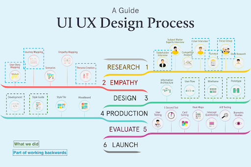
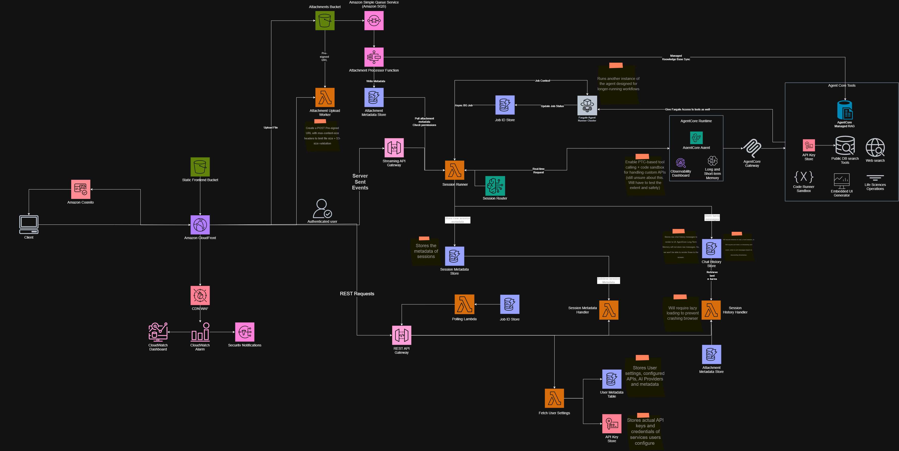

**Project Completion Documentation** 

CEI Life Sciences Bot

**TO DO (project team):** add the client logo image here (for example `./media/project-closure/client-logo.png`) and update this line to show it.

**Authors:** 

**GitHub: RETR0-OS, sreeram2001**

**TO DO (project team):** these are the two GitHub usernames with commits in this repository. Add the real full names and project roles (for example "Jane Doe (RETR0-OS) – Full Stack Developer").

**Project Closure Date:**

**TO DO (project team):** this repository is still in active development at the time of writing (most recent commit 13-November-26; `docs/architectureDeepDive.md` and the roadmap list several phases as "in progress" or "not started," and F21 hardening has not started). Add the real closure date once the project formally closes.

### 

**Table of Contents**

**1[. Executive Summary](#1-executive-summary)**

**2[. Project Overview](#2-project-overview)**

2[.1 AWS Leads](#21-aws-leads)

2[.2 ASU Build Team](#22-asu-build-team)

2[.3 Project Timeline](#23-project-timeline)

2[.4 Project Timeline and Sprints](#24-project-timeline-and-sprints)

[**3\. Project Performance**](#3-project-performance)

[3.1 Problem Statement](#31-problem-statement)

[3.2 Project Scope](#32-project-scope)

[3.3 Deliverables](#33-deliverables)

[**4\. Development**](#4-development)

[4.1 UI/UX](#41-uiux)

[4.2 System Architecture](#42-system-architecture)

[4.3 Technology Stack](#43-technology-stack)

[4.4 Key Features Implementation](#44-key-features-implementation)

[4.5 Deployment](#45-deployment)

[**5\. Challenges**](#5-challenges)

[**6\. Future Scope**](#6-future-scope)

[**7\. Appendix**](#7-appendix)

### 

### **1\. Executive Summary** {#1-executive-summary}

### ---

The ASU AI Cloud Innovation Center (CIC), built with AWS, develops the CEI Life Sciences Bot for life sciences teams who must research, draft, and analyze information across many separate public data sources today. A researcher who wants a grounded answer must search PubMed, ClinicalTrials.gov, bioRxiv, medRxiv, ChEMBL, Open Targets, CMS Coverage, ICD-10, NPI, PubChem, openFDA, USPTO PatentsView, and NCBI tools one at a time, then copy findings into a separate document for drafting or analysis, with no shared citation trail.

The solution is a multi-agent AI assistant with four specialist agents — Research, Drafting, Analysis, and a Pipeline Manager that orchestrates the other three — each reachable through a web dashboard. The agents query the data sources above through one AWS Bedrock AgentCore Gateway, under a default-deny Cedar access policy, and stream their answers to the browser as they work, with an auditable trace of every tool call and source. Every user's chats, keys, and data are isolated from every other user; there is no sharing between users.

At the time of writing, the project is a working prototype, not a finished, client-deployed product. The frontend (Cognito sign-in, S3 + CloudFront + WAF hosting), the REST API, the AgentCore Gateway and its 12 data-source tools, the four specialist agents, a guided one-command deployment pipeline (`deploy.sh` + AWS CodeBuild), and an initial CloudWatch/SNS alarm set all exist in code and in AWS CDK. Several features — full background-job handoff for non-pipeline agents, the 11-profile single-source "tool agent" runtime, user-supplied API keys, and full account-deletion cascade including attachments — are partly built or not yet built; `docs/architectureDeepDive.md` marks the exact status of every component. Because the product has not yet gone live with real users, business impact and benefit figures are not yet measured; the expected benefit is faster, better-grounded life sciences research, drafting, and analysis for a team that otherwise works across many disconnected tools by hand.

### 

### **2\. Project Overview**

---

 {#2-project-overview}

#### **2.1 AWS Leads** {#21-aws-leads}

**TO DO (project team):** list the AWS team members and their roles (for example Solution Architect, Digital Innovation Lead, Project Manager, Account Manager). This information is not in the repository.

#### **2.2 ASU Build Team** {#22-asu-build-team}

The repository's commit history shows two GitHub contributors:

- RETR0-OS
- sreeram2001

**TO DO (project team):** add each contributor's full name and project role (for example Full Stack Developer, UI/UX Designer).

#### **2.3 Project Timeline** {#23-project-timeline}

27-August-26 (first commit) – ongoing. The most recent commit at the time of writing is 13-November-26.

**TO DO (project team):** add the formal project closure date once the project closes; see the note on page 1.

#### **2.4 Project Timeline and Sprints** {#24-project-timeline-and-sprints}

The table below is reconstructed from `.agents/decision-log.md` (dated decisions), `.agents/roadmap.md` (phase status), and the commit history. No formal sprint schedule with planned dates exists in the repository, so the last column shows the actual date range of each iteration instead of a planned date.

| Item # | Iteration | Deliverables | Date range (actual) |
| :---- | :---- | :---- | :---- |
| **1** | **Architecture planning** | Target architecture, streaming protocol, tool-scope model, data model, and the phase roadmap (decision log B1–B86) | **27-Aug-26 – 29-Sep-26** |
| **2** | **Deploy foundation and hosting (F1, F2)** | `deploy.sh` + CodeBuild deployment pipeline and CDK skeleton (F1, done); Cognito self sign-up, S3 + CloudFront + WAF dashboard hosting, the `EdgeWafStack` web ACL (F2, done) | **30-Sep-26 – 05-Oct-26** |
| **3** | **API, data tools, Research agent (F3–F5, S1, S2)** | Regional REST API and session store (F3, done); AgentCore Gateway with 10 data-source Lambdas and Cedar policy (F4, in progress); Research agent live on AgentCore Runtime with the Session Router and Session Runner (F5, in progress); streaming and tool-scope spikes (S1, S2) | **06-Oct-26 – 28-Oct-26** |
| **4** | **MVP demo slice (B94–B98)** | Analysis agent (competitor, market, legal-landscape) and Pipeline Manager running locally, with CEI UI 1.1, built ahead of the full F14/F17 work for a client demonstration | **decided 06-Oct-26, built alongside Item 3** |
| **5** | **Streaming UI, export, model controls, HITL (F6–F9, F11–F13)** | CEI UI 1.2 progressive streaming (F6, in progress); Drafting agent and document export (F7, partial); model picker, Guardrails, prompt caching (F8, partial); free-text router classifier (F9, partial); long-term memory recall (F11, partial); Web Search connector and Life Sciences Operations Lambda (F12, partial); human-in-the-loop pause/resume (F13, partial) | **29-Oct-26 – 10-Nov-26** |
| **6** | **Any-model selection, account deletion, gap fixes (B99–B110)** | Any-Bedrock-model selection, prompt-caching trade-offs, account deletion by disable-and-9-hour-delayed-sweep (behind a flag, default off), managed Knowledge Base design, interim handling for long Research requests | **28-Oct-26 – 11-Nov-26** |
| **7** | **Documentation and hardening in progress** | Updates to `docs/`, the decision log, the roadmap, and the phase files; full live-AWS verification and security hardening (F21) have not started | **11-Nov-26 – 13-Nov-26 (most recent commit)** |

### 

### **3\. Project Performance** {#3-project-performance}

### ---

### 

#### **3.1 Problem Statement** {#31-problem-statement}

Life sciences teams need to research drugs, targets, trials, and competitors; draft grants, investor materials, journal articles, and whitepapers; and run competitor, market, and legal-landscape analysis. Today this means working across many separate tools and databases by hand: PubMed, ClinicalTrials.gov, bioRxiv, medRxiv, ChEMBL, Open Targets, CMS Coverage, ICD-10, NPI, PubChem, openFDA, USPTO PatentsView, and NCBI's taxonomy, sequence-search, and BLAST tools. Each has its own search syntax and its own way of citing a result.

This costs time: a researcher switches between many browser tabs, copies findings by hand into a draft document, and has no single, shared, auditable trail of which source backed which claim. Existing single-purpose search tools and generic chatbots do not solve this: a single-purpose tool only covers one data source, and a generic chatbot has no grounded connection to any of these specific sources, no citation discipline, and no way to isolate one user's work from another's. The project's many separate users (researchers, drafters, and analysts, each with their own fully isolated chats, keys, and files — no sharing, no teams) need one assistant that can search the right sources, ground every claim in a real citation, draft a document from the findings, and run a structured analysis, all in one place.

#### **3.2 Project Scope** {#32-project-scope}

##### **In Scope**

- A web dashboard (Vite + React single-page app) with Cognito self sign-up, email verification, and an email-domain allowlist, served from S3 behind CloudFront and AWS WAF.
- One Regional REST API (API Gateway v1) with a Cognito authorizer; `/chat/stream` streams a chat turn as Server-Sent Events, every other route is a normal buffered call.
- Four specialist agents on Amazon Bedrock AgentCore Runtime, each a Python LangGraph application: Research (deep research with citation grounding), Drafting (document preparation and export), Analysis (competitor, market, and legal-landscape analysis), and a Pipeline Manager that orchestrates the other three.
- An AgentCore Gateway in front of 12 public data-source Lambda tools (PubMed, ClinicalTrials.gov, bioRxiv, medRxiv, ChEMBL, Open Targets, CMS Coverage, ICD-10, NPI, PubChem, openFDA, USPTO PatentsView) plus read-only NCBI tools, gated by a default-deny Cedar access policy and per-source Cognito scopes.
- A deterministic Session Router for dashboard tasks, and a small fixed Bedrock model as a free-text classifier that picks the right agent, or asks the user to pick one when it is not confident.
- A deterministic Biopython/RDKit Life Sciences Operations tool (sequence, protein, chemistry, and lab calculations) with no model call.
- CEI UI 1.1 (completed answers) and, for the Research agent, CEI UI 1.2 progressive streaming, with a collapsible "thinking block" showing the agent's tool calls and reasoning.
- Human-in-the-loop pause and resume points: Research clarifying questions, Drafting outline approval, Analysis scope confirmation, and Pipeline Manager plan approval.
- Document export to PDF, DOCX, Markdown, CSV, and LaTeX, with a review-acknowledgment gate before download.
- A model picker (any Bedrock model, subject to a configurable blocklist), a per-chat science/business mode, Amazon Bedrock Guardrails on every model call, and prompt caching.
- Account deletion (disable the account at once, then a full data-removal sweep after a 9-hour delay), behind a feature flag that defaults to off.
- A guided, one-command deployment: `deploy.sh` collects configuration and starts an AWS CodeBuild build that runs every build, bootstrap, and deploy step.
- Initial CloudWatch dashboards and SNS email alarms for API/Lambda errors, security events, and Guardrail interventions.

##### **Out of Scope**

- Chat deletion. A user can delete their whole account, but not a single chat (decision B104).
- Programmatic tool calling — letting a model write code that itself calls Gateway tools (deferred, needs its own safety review; see `.agents/phases/later.md`).
- Slide deck (PPTX) export (deferred; PDF, DOCX, Markdown, CSV, and LaTeX are in scope).
- User-configured paid data sources and their billing model (deferred to a later discussion).
- A user interface for viewing or editing an agent's long-term memory (deferred; the MVP only reads and writes memory in the background).
- The 11-profile single-source "tool agent" runtime and its `/tools/{source}/chat/stream` route (the LangGraph graph and YAML profiles exist in code; no runtime is deployed).
- User-supplied API key storage and use in the data-source Lambdas (the lookup code exists; the settings page, grant, and route do not).
- File attachments and Retrieval-Augmented Generation over a user's own documents (excluded from the current iteration; see `docs/operations.md`).
- A full, proven background-job handoff for Research, Drafting, and Analysis when a run is predicted to take more than ten minutes (today this returns a "background processing unavailable" message instead, decision B100).
- Live, production AWS verification of most built features and the final security-hardening pass (phase F21), which have not started.

#### **3.3 Deliverables** {#33-deliverables}

* The `founder-ai-dashboard` web application (`frontend/`): a Vite + React 19 + Tailwind CSS 4 single-page app with Cognito-gated sign-in.
* AWS CDK infrastructure as code (`backend/`): `BackendStack` (the REST API, Cognito, AgentCore resources, DynamoDB tables, S3 buckets, observability) and `EdgeWafStack` (the CloudFront-scope WAF web ACL in `us-east-1`).
* Agent code (`backend/agents/`): the four specialist LangGraph agents and the tool-agent graph with its data-source YAML profiles.
* The AgentCore Gateway configuration, its 12 data-source Lambda targets plus NCBI tools, and the Life Sciences Operations Lambda.
* A guided deployment pipeline: `deploy.sh` at the repository root and `buildspec.yml` for AWS CodeBuild.
* The project documentation set in `docs/`: this closure document, the architecture deep dive, the deployment guide, the user guide, the API documentation, the modification guide, the CEI UI protocol specification, the operations runbook, and a development-stage security review.
* Automated test suites: Jest (frontend and backend CDK), `pytest` (agents), and Node's built-in test runner (several Lambda handlers).
* An initial CloudWatch operations dashboard and SNS email alarm set.

### 

### **4\. Development** {#4-development}

---

#### 

#### **4.1 UI/UX** {#41-uiux}

#### ---

#### 

#### **Who are the users of this application?**

The users are life sciences professionals who need to research, draft, and analyze information: for example biotech founders, business development staff, and scientists at a life sciences organization. Every user's account is fully isolated — their chats, API keys, uploaded files, and settings are visible only to them. There is no sharing and no teams; this is a many-isolated-users product, not a single shared workspace.

#### **Why are the users using this application?**

Users want one assistant that can search the right public data source for their question, ground every answer in a real, checkable citation, draft a document (a grant application, an investor deck, a journal article, or a whitepaper) from research findings, run a structured competitor, market, or legal-landscape analysis, and chain these steps together in a multi-agent pipeline when a task needs more than one agent — all without manually switching between a dozen separate tools.

#### **What is the customer opportunity statement?**

A life sciences team that uses many separate search tools and writes documents by hand can save research and drafting time, and gain a consistent, auditable citation trail, by using one assistant that already knows how to query 12 public data sources plus NCBI, ground its answers, draft documents in the team's preferred format, and keep every user's work private to that user.

#### **User Interface**

**TO DO (project team):** add a screenshot of the dashboard sign-in / task launcher screen here (for example `./media/project-closure/screenshot-dashboard.png`), with a caption.

**TO DO (project team):** add a screenshot of a chat in progress, with the thinking block expanded, here (for example `./media/project-closure/screenshot-chat.png`), with a caption.

#### 

#### **4.2 System Architecture** {#42-system-architecture}

The system is a multi-agent AI assistant behind a web dashboard. A user signs in through Amazon Cognito, picks a task or types a free-text message, and the request is routed to one of four specialist agents running on Amazon Bedrock AgentCore Runtime. Each agent reaches its tools — 12 public data-source APIs, NCBI tools, a deterministic Life Sciences Operations calculator, and (where enabled) web search — through one AgentCore Gateway, gated by a default-deny Cedar access policy so an agent can only reach the tools its current request is scoped to. The Research agent streams its answer back to the browser piece by piece; the other three agents return a completed answer today. `docs/architectureDeepDive.md` gives the full, component-by-component status (Exists / Exists (partial) / Planned) behind this summary.

##### **Architecture Diagram**

> This diagram shows an earlier design (for example, a Fargate cluster for background jobs, and separate streaming and REST API Gateway boxes) and is not kept up to date. See the "Differences from the diagram" table in `docs/architectureDeepDive.md` for exactly what changed and why; treat that table, not this picture, as current.

##### **Workflow Description**

1. **Sign-in:** The browser loads the dashboard from CloudFront (fronted by AWS WAF), and the user signs in through Amazon Cognito managed login (Authorization Code + PKCE). Cognito checks a configured email-domain allowlist at sign-up.
2. **Request:** The user picks a task from the dashboard, or types a free-text chat message. The browser calls `POST /chat/stream` on the Regional REST API, authenticated with the Cognito access token.
3. **Routing:** The Session Runner Lambda (Node.js) calls the Session Router Lambda (Python). A dashboard task routes deterministically to its matching agent; free text goes to a small, fixed Bedrock model that classifies the request into Research, Drafting, Analysis, or Pipeline Manager, or asks the user to pick one if it is not confident.
4. **Agent run:** The Session Router starts the chosen agent on Amazon Bedrock AgentCore Runtime, with a Cognito machine-to-machine token scoped to only the tools that run needs. The agent (a Python LangGraph application) plans its steps and calls tools as needed.
5. **Tool access:** Each tool call goes through the AgentCore Gateway, which checks a Cedar access policy before letting the call reach a data-source Lambda, the Life Sciences Operations Lambda, the Code Interpreter, or (where enabled) the Web Search connector. A denied call never reaches the underlying tool.
6. **Streaming the answer:** For the Research agent, each piece of the answer streams back through the Session Runner as Server-Sent Events, rendered in the browser as a progressively-built CEI UI surface, with a collapsible "thinking block" showing the live tool calls and reasoning. The other three agents return one completed answer.
7. **Pausing for input:** At defined points (for example, Drafting's outline approval, or Pipeline Manager's plan approval), an agent pauses with a human-in-the-loop question. The user answers through `POST /ui-actions`, and the agent resumes from exactly where it paused.
8. **Storage:** The session, its chat history, and its trace of tool calls and sources are stored in DynamoDB, partitioned by the signed-in user, so one user never sees another user's data.
9. **Long-running work:** The Pipeline Manager always runs as a background job, tracked in a Job ID Store and visible in a jobs list and a `/pipeline` view; a user can check progress or cancel. For the other three agents, a background-job handoff for long requests is designed but not yet fully built.

#### 

#### **4.3 Technology Stack** {#43-technology-stack}

##### **Frontend**
- **Vite + React 19 + Tailwind CSS 4** (`frontend/`, the `founder-ai-dashboard` single-page app), with `react-router` for client-side routing.
- **Hosting**: Amazon S3 (private bucket) behind Amazon CloudFront, with AWS WAF (its own `CLOUDFRONT`-scope web ACL, deployed in `us-east-1`) in front of it. CloudFront serves the SPA's `index.html` as a fallback for client-side routes.

##### **Backend Services**
- **Amazon API Gateway (REST API v1)**: one Regional API for every route; `/chat/stream` streams responses, every other route is buffered.
- **AWS Lambda**: the Session Runner (Node.js/TypeScript, native response streaming) and most other handlers (Python) — the Session Router, session/history/export/jobs handlers, the data-source tool Lambdas, and the Life Sciences Operations Lambda.
- **Amazon Bedrock AgentCore**: Runtime (the four specialist agents, each a Python LangGraph application), Gateway (tool access with Cedar policy), Memory (checkpointing and long-term recall, Research agent today), and Code Interpreter (sandboxed code execution for analysis and charts).
- **Amazon Cognito**: self sign-up user pool with email verification, an SPA app client (Authorization Code + PKCE, managed login), and a machine-to-machine client used only by the Session Router.

##### **Data Storage**
- **Amazon DynamoDB**: session metadata, chat history (with the trace stored inline), export metadata, active-run tracking, the Job ID Store, an NCBI rate-limit table, and per-user settings.
- **Amazon S3**: generated report/export files (Intelligent-Tiering) and an attachments bucket for planned file uploads.

##### **AI/ML Services**
- **Amazon Bedrock**: foundation models (any supported model, subject to a configurable blocklist) for the four agents and the router classifier, with Amazon Bedrock Guardrails on every model call and prompt caching on supported models.

##### **Infrastructure**
- **AWS CDK** (TypeScript): Infrastructure as Code for both stacks, checked with `cdk-nag`.
- **AWS CodeBuild**: runs every real build, bootstrap, test, and deploy step, started by the local `deploy.sh` script.
- **Amazon CloudWatch + Amazon SNS**: an operations dashboard and email alarms for API/Lambda errors, security events, and Guardrail interventions.

#### 

#### **4.4 Key Features Implementation** {#44-key-features-implementation}

##### **Feature 1: Progressive streaming answers (CEI UI 1.2)**
The Research agent streams its answer to the browser piece by piece instead of waiting for the full answer. A Node.js Session Runner Lambda relays Server-Sent Events from the AgentCore Runtime to the browser over `fetch` + `ReadableStream` (not `EventSource`, because `EventSource` cannot send the required `Authorization` header), with a heartbeat comment every 17 seconds to keep the connection alive. The frontend renders each event as it arrives, building a CEI UI component graph progressively and populating a collapsible "thinking block" with the agent's tool calls and reasoning as they happen, then collapsing it once the answer is complete. The other three agents still return one completed CEI UI 1.1 answer; the Session Runner turns that single answer into the same event stream so the frontend code does not need two code paths.

##### **Feature 2: Scoped multi-agent tool access (AgentCore Gateway + Cedar Policy)**
All four agents reach their external tools — 12 public data-source APIs, NCBI's taxonomy/sequence/BLAST tools, the Life Sciences Operations calculator, and an optional web search connector — through one AgentCore Gateway. A Cedar access policy, set to default-deny, grants one permit per data source; a Cognito resource server issues one scope per source plus one shared scope for common tools. The Session Router is the only component that holds the machine-to-machine client secret: for each run, it requests a token scoped to only the sources that run is allowed to use, and the agent never sees the secret itself. A deployed spike proved this design: Cedar's `tools/list` filtering hides tools a token is not scoped for, and a policy denial comes back as an HTTP 200 response containing a JSON-RPC error, not an HTTP error — so the agent code checks the JSON-RPC error code, not the HTTP status, to detect a denial.

##### **Feature 3: Human-in-the-loop pause and resume**
Research, Drafting, Analysis, and the Pipeline Manager each pause at a defined point — a clarifying question, an outline approval, a scope confirmation, or a plan approval — using a real LangGraph `interrupt`. The paused state is checkpointed, and the stream ends with a question surface instead of an error. The user's answer goes to `POST /ui-actions`, which resumes the same agent run from exactly where it paused, rather than starting over. There is no fixed time limit on how long a user can take to answer.

##### **Feature 4: Guided, one-command deployment**
`deploy.sh` at the repository root collects configuration (Region, default and blocked Bedrock models, allowed sign-up email domains, rate limits, an admin alert email) and starts one AWS CodeBuild build. Every real build step — installing dependencies, a Region capability pre-flight check, building the frontend, bootstrapping CDK, running tests, and `cdk deploy`— runs inside that CodeBuild build, never on the operator's own machine. This was a deliberate design change (see Challenge 1 in section 5) after an early version of the script tried to run some of these steps locally and failed.

##### **Feature 5: Account deletion with a delayed sweep**
A user can delete their entire account (chat history, trace, long-term memory, and stored keys). The route disables the Cognito user and signs them out everywhere at once, so no new activity can start, but the actual data removal runs about nine hours later — long enough for any already-running agent session or a timed-out retry to finish first — so a late write can never "resurrect" data the sweep already removed. This feature is built and tested, but deployed behind a feature flag that defaults to off, pending live verification.

#### 

#### **4.5 Deployment** {#45-deployment}

Deployment is a single-environment model: one deployment per AWS account and Region, with no separate dev/staging/production stacks. A developer can still run the four agents locally with the AgentCore CLI before anything is deployed to AWS.

##### **Prerequisites**
- AWS CLI v2, signed in with credentials for the target AWS account.
- Node.js 20 or later (used only to write a small JSON configuration file locally; the real `npm` steps run inside AWS CodeBuild).
- git and bash (AWS CloudShell already has both, plus the AWS CLI and Node.js, so it needs no extra setup).
- IAM permissions to create the one-time deployment IAM role and AWS CodeBuild project that `deploy.sh` uses (listed in full in `docs/deploymentGuide.md`).

##### **Deployment Steps**
1. Run `./deploy.sh` from the repository root and answer its prompts (Region, default and blocked Bedrock models, allowed sign-up email domains, rate limits, an admin alert email), or pass the equivalent flags for a non-interactive run.
2. `deploy.sh` writes the configuration, creates or updates the one-time deployment IAM role and the AWS CodeBuild project, and starts a build, pinned to a specific commit.
3. AWS CodeBuild installs dependencies, runs a Region capability pre-flight check, builds the frontend, bootstraps AWS CDK (only in Regions that need it), runs the test suite, and deploys both CDK stacks (`BackendStack` and `EdgeWafStack`).
4. `deploy.sh` polls the build and reports success or failure, with a link to the full build log.
5. After a successful deploy, follow the post-deployment verification checklist in `docs/deploymentGuide.md` (sign-up with an allowed and a disallowed email domain, a deep-link reload test, and a `/chat/stream` smoke test) before treating the environment as usable.

### 

### **5\. Challenges** {#5-challenges}

#### ---

- **Challenge 1: HTTP API Gateway (v2) cannot stream a response.** The original design used separate streaming and REST API Gateway boxes.
  - **Solution:** The project moved to one Regional REST API (v1) for every route, with `/chat/stream` set to `responseTransferMode: STREAM` and every other route left as a normal buffered call. One Cognito authorizer covers both modes (decision B2).

- **Challenge 2: Running `cdk bootstrap` locally failed because the frontend was not built yet.** An early version of `deploy.sh` ran `cdk bootstrap` on the operator's own machine. Bootstrapping triggers a CDK synth, and the synth needs a real `frontend/dist` folder to exist, which it did not when `deploy.sh` was run fresh from AWS CloudShell.
  - **Solution:** Every real build step — installing dependencies, the Region pre-flight check, building the frontend, `cdk bootstrap`, and `cdk deploy` — was moved into one AWS CodeBuild build, in a fixed order that builds the frontend before anything that needs it (decision B91).

- **Challenge 3: A Cedar policy denial does not look like a normal error.** A deployed spike found that the AgentCore Gateway answers a policy-denied tool call with an HTTP 200 response containing a JSON-RPC error, not an HTTP error code — and a separate case, an expired access token, comes back as HTTP 403, not the HTTP 401 that was expected.
  - **Solution:** Agent and token-refresh code was written to check the JSON-RPC `error.code` field for a policy denial, and to treat an HTTP 403 as a possible sign of an expired token worth one refresh-and-retry, instead of relying on HTTP status codes alone (spike finding S2).

- **Challenge 4: A background worker's import chain did not match what was actually deployed.** The account-deletion worker Lambda imported a helper module that needed a package not included in the deployed Python dependency layer, so the deployed worker would have failed every time it ran and never actually deleted an account.
  - **Solution:** The worker's memory-deletion code was rewritten to use only the AWS SDK (`boto3`) already present in the layer, and a guard test now checks the worker's full import chain against the layer's actual contents, so this class of mismatch is caught before deployment.

- **Challenge 5: The AgentCore Gateway does not forward the calling user's identity to a tool Lambda.** The original design expected a data-source Lambda to read the calling user's Cognito `sub` from the Gateway request, to look up that user's own optional API key. AWS's own Gateway documentation confirms it does not pass the caller's token through to Lambda targets.
  - **Solution:** Until a Gateway-side interceptor (or another mechanism) is built and decided (deferred to phase F18), every data-source Lambda call runs on the free, no-key path. User identity is deliberately never taken from a tool's own call arguments, because the calling agent controls those (decision B99).

### 

### **6\. Future Scope** {#6-future-scope}

### ---

* Finish the AgentCore Runtime async-session background-job path (phase F16) so Research, Drafting, and Analysis — not only the Pipeline Manager — can hand off a long-running request instead of returning a "background processing unavailable" message.
* Deploy the 11-profile single-source "tool agent" runtime and its `/tools/{source}/chat/stream` route (phase F15), so a user can chat with one data source directly (for example, "Ask PubMed").
* Build user-supplied API key storage and use (phase F18), so a user can add their own key to a source (for example NCBI) for a higher rate limit, and support for user-configured paid data sources (deferred item in `.agents/phases/later.md`).
* Ship file attachments and Retrieval-Augmented Generation over a user's own documents, backed by an Amazon Bedrock Knowledge Base (phase F10, currently excluded from this iteration).
* Extend account data deletion to cover attachments and Knowledge Base chunks once those stores exist (phase F19), and move the account-deletion feature out from behind its current off-by-default flag after live verification.
* Move the Pipeline Manager from running its steps in-process to dispatching each step to its own AgentCore Runtime session (the originally designed `InvokeAgentRuntime` pattern, decision B83/B102).
* Add a user interface for viewing long-term agent memory (deferred item in `.agents/phases/later.md`).
* Add slide deck (PPTX) export alongside the existing PDF, DOCX, Markdown, CSV, and LaTeX formats (deferred item in `.agents/phases/later.md`).
* Review and, if approved, add programmatic tool calling — letting a model write code that itself calls Gateway tools — behind its own dedicated safety review (deferred item in `.agents/phases/later.md`).
* Complete the full security-hardening and live-AWS-verification pass (phase F21), which depends on every other phase and has not started.

#### 

### **7\. Appendix** {#7-appendix}

#### ---

**GitHub Repository** - https://github.com/ASUCICREPO/CEI_Life_Sciences_Bot

**Figma Link (Internal)** - For the currently implemented version - **TO DO (project team):** add the Figma link if one exists; this repository has no Figma reference.

**Figma Link (Internal)** - For the future scope - **TO DO (project team):** add the Figma link if one exists, or delete this line.

**Project Demo Recording** - **TO DO (project team):** add a link to a recorded demo.

**Drive Link** - **TO DO (project team):** add a shared drive link for project files, if one exists.

**Additional resources:**

- [Architecture Deep Dive](./architectureDeepDive.md) — the full target architecture, with the exact build status of every component.
- [Deployment Guide](./deploymentGuide.md) — the deployment model, `deploy.sh`, and post-deployment verification steps.
- [User Guide](./userGuide.md) — the planned and built user journeys.
- [API Documentation](./APIDoc.md) — the route table and the status of each route.
- [Operations](./operations.md) — monitoring, alarms, and known verification gaps.
- [Development-stage security review](./security-review-development.md) — a focused source review and its open follow-up items.
